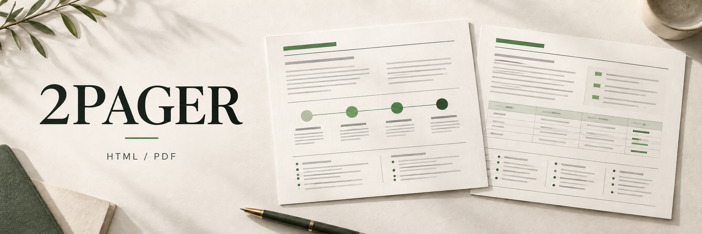
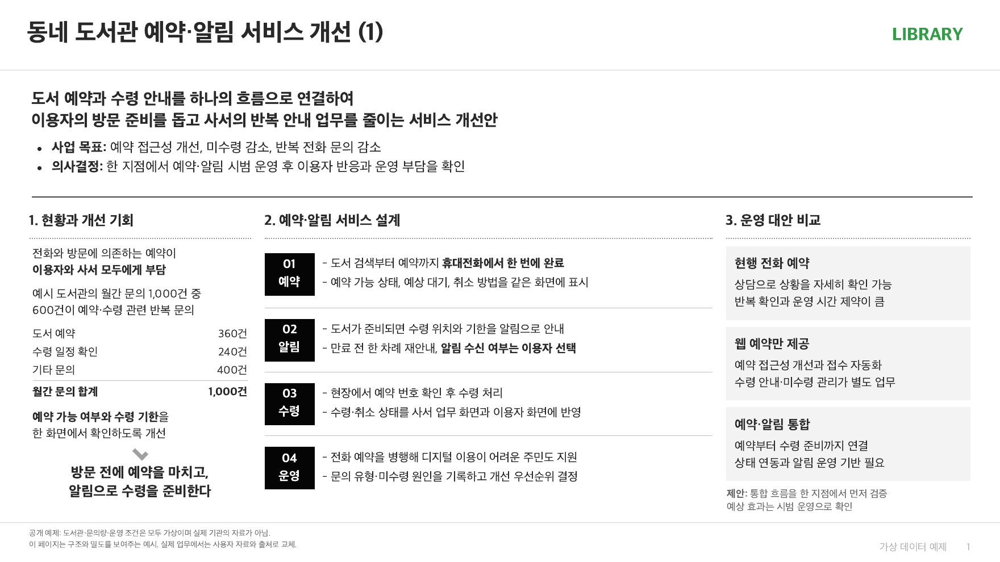
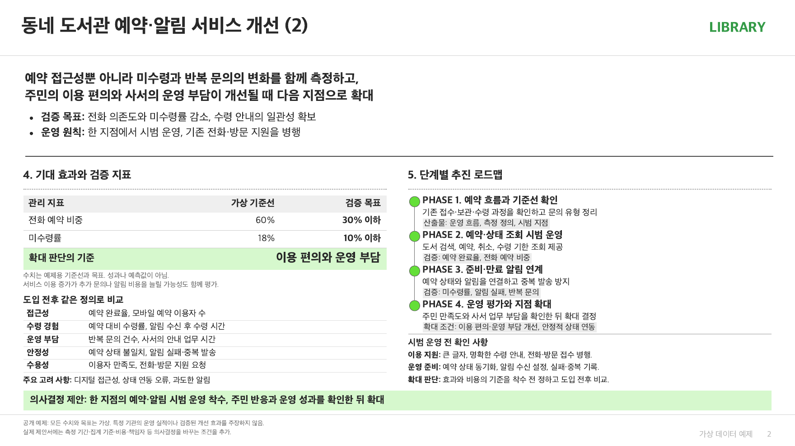

[](README.ko.md)

# Two Pager Skill

A shared skill for Codex and Claude Code that turns long notes into **two-page executive proposals and decision briefs**. Built to reduce Korean text clipping, distracting numerical emphasis, image placement rework, and repetitive PDF export steps.

**Outputs:** editable HTML, a shareable PDF, and a preview image for each page.

## Example: Neighborhood library reservations and notifications

A fictional case with no connection to a real institution. Inquiry counts, baselines, and targets are illustrative; no company data, logos, or product UI are included. The Korean-language previews below are **actual browser renders of this skill's HTML template**.

### Page 1 · Current situation, service design, and operating alternatives



### Page 2 · Expected effects, validation metrics, and roadmap



[Example PDF](docs/library-two-pager.pdf) · [Example HTML](docs/library-two-pager.html)

## Installation

All shared code lives in `skills/two-pager/`. The repository's `.agents/skills/two-pager` and `.claude/skills/two-pager` are relative symlinks to that directory. Both tools read the same `SKILL.md` and scripts, so there are no separate code copies to maintain. No model API, MCP server, or other skill is required. Use a Codex or Claude Code environment that can create local files and run commands.

### macOS / Linux

```bash
git clone https://github.com/nathankim0/two-pager-skill.git
cd two-pager-skill
```

Alternatively, install without Git using the ZIP from the [latest release](https://github.com/nathankim0/two-pager-skill/releases/latest). Extract it where no `two-pager-skill` directory already exists, then continue with the symlink commands below.

```bash
curl -fL https://github.com/nathankim0/two-pager-skill/releases/latest/download/two-pager-skill.zip -o two-pager-skill.zip
unzip two-pager-skill.zip
cd two-pager-skill
```

Install for Codex:

```bash
mkdir -p ~/.agents/skills
ln -s "$PWD/skills/two-pager" ~/.agents/skills/two-pager
```

Install for Claude Code:

```bash
mkdir -p ~/.claude/skills
ln -s "$PWD/skills/two-pager" ~/.claude/skills/two-pager
```

Run both commands to share the skill between the tools. If a skill with the same name already exists, check its location before replacing it. Moving or deleting the repository will break these links. For a Git installation, update by running `git pull` in the repository.

For use within this repository, the included project symlinks let both tools discover the skill. To use it only in another project, create links to the shared directory in that project's `.agents/skills/` and `.claude/skills/`. For ZIP installations, update the shared directory from a newer release package.

### Windows PowerShell

Enable Developer Mode or use an administrator PowerShell session to create symlinks. Set `core.symlinks` when cloning so Git preserves the repository's links.

```powershell
git -c core.symlinks=true clone https://github.com/nathankim0/two-pager-skill.git
cd two-pager-skill

New-Item -ItemType Directory -Force "$HOME/.agents/skills"
New-Item -ItemType Directory -Force "$HOME/.claude/skills"
$sharedSkill = (Resolve-Path ./skills/two-pager).Path
New-Item -ItemType SymbolicLink -Path "$HOME/.agents/skills/two-pager" -Target $sharedSkill
New-Item -ItemType SymbolicLink -Path "$HOME/.claude/skills/two-pager" -Target $sharedSkill
```

Run these commands only when the destination links do not already exist. Both tools will reference the same shared directory.

If Codex does not show the skill, start a new session. In Claude Code, check with `/two-pager`. Installation paths follow the [Codex documentation](https://learn.chatgpt.com/docs/build-skills#where-codex-loads-local-skills) and [Claude Code documentation](https://code.claude.com/docs/en/skills#choose-where-skills-load).

## Usage

Codex:

```text
$two-pager
Turn the notes below into a two-page executive brief.
Follow the layout and density of the attached slides, keeping key evidence and conditions.
```

Claude Code:

```text
/two-pager
Condense this proposal into two pages and create HTML and PDF files.
Use page 1 for the current situation and proposal, and page 2 for effects and the rollout plan.
```

Include reference slides, relevant images, and brand fonts or logos when available. The skill follows the user's language. Label supplied AI-generated UI as a concept, and do not copy rewards, prices, or interactions that contradict the written proposal.

## Run directly

Requires **Python 3.10 or later**. On the first render, the helper installs Playwright, pypdf, and Pillow in a shared cache. Later runs reuse that runtime. It uses an installed Chrome/Chromium first; otherwise, it downloads Chromium once.

The Python runtime is stored in `~/.cache/two-pager/` and respects `XDG_CACHE_HOME`. A repeat export of the two-page PDF, previews, and checks took about 2.4 seconds on a local macOS machine with Chrome installed, excluding dependency setup. Timing depends on the environment and document.

```bash
# 1. Create an editable draft
python3 skills/two-pager/scripts/two_pager.py scaffold ./work/brief \
  --title "Library reservations and notifications" --brand "LIBRARY"

# 2. Replace the example content in work/brief/two-pager.html with your proposal

# 3. Export, validate, and generate previews in one run
python3 skills/two-pager/scripts/two_pager.py render \
  ./work/brief/two-pager.html --output-dir ./output/brief
```

Generated files:

```text
output/brief/
├── two-pager.html
├── two-pager.pdf
└── .qa/two-pager/
    ├── page-1.png
    ├── page-2.png
    └── report.json
```

Inspect both images in `.qa`, then deliver the HTML and PDF. If layout validation fails, the helper keeps the previews and report while preserving any previously successful final files.

Crop an image:

```bash
python3 skills/two-pager/scripts/two_pager.py crop ./ui.png \
  --box 344 112 312 600 --output ./work/brief/quest.png
```

`--box` specifies `x y width height` in the original image's coordinates. These example coordinates are not a preset for other images. Add `` to the HTML; the helper embeds the image into the exported HTML during rendering. The original image stays intact. Use relative image paths and inline CSS; remote resources are blocked during export.

To select a browser, use `render --browser /path/to/chrome`. If Korean text appears as boxes on Linux, install a Korean font, such as Ubuntu's `fonts-noto-cjk`. Servers missing Chromium system libraries may also need `python -m playwright install --with-deps chromium` from the Playwright runtime.

## Lessons that make the next brief faster

| What caused rework | How this skill handles it |
| --- | --- |
| A large supporting number distracted from the recommendation | Choose emphasis by decision importance; keep supporting figures in body copy |
| Korean words broke between syllables | Use `word-break: keep-all` and meaningful line breaks |
| Linux CJK font leading triggered false overlap reports | Compare visible glyph bounds and set explicit block line heights |
| Long stage labels pushed the last row down | Use short two-line labels and a fixed content area |
| Adding an image late forced a full layout revision | Reserve image space first and crop to the relevant area |
| A generated UI contradicted the proposal | Label it as a concept and select a consistent crop |
| Every export recreated a virtual environment | Cache the runtime by Python version and dependency list |
| PDF, preview, and page checks ran separately | Combine them in one browser run |
| A failed revision overwrote a working PDF | Replace final files only after validation passes |

See the [layout notes](skills/two-pager/references/layout-lessons.md) for details. Automated checks cover text and image overlap, content overflow, PDF page count, and page dimensions. They do not guarantee factual accuracy, color contrast, font quality, or display in every application.

## Development and validation

```bash
python3 -m pip install -r skills/two-pager/scripts/requirements.txt
python3 -m unittest discover -s tests -v
```

Tests cover two-page output and Korean text extraction, rejection of invalid crops, original image preservation, rejection of remote images, visible text overlap detection, and preservation of final files after a page-count failure. GitHub Actions runs the same tests with Linux Chromium and Korean fonts.

## Scope

The default template is a two-page, 16:9 landscape brief. For a different reference, adjust the HTML layout and print dimensions together. Long slide decks and editable PPTX generation are outside this helper's scope.

The cover is AI-generated; its prompt is in [docs/cover-prompt.txt](docs/cover-prompt.txt). Both library preview images are actual renders. Licensed under [MIT](LICENSE).
